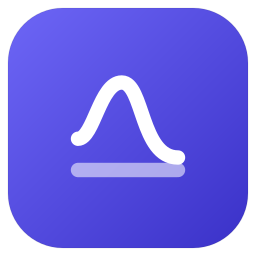
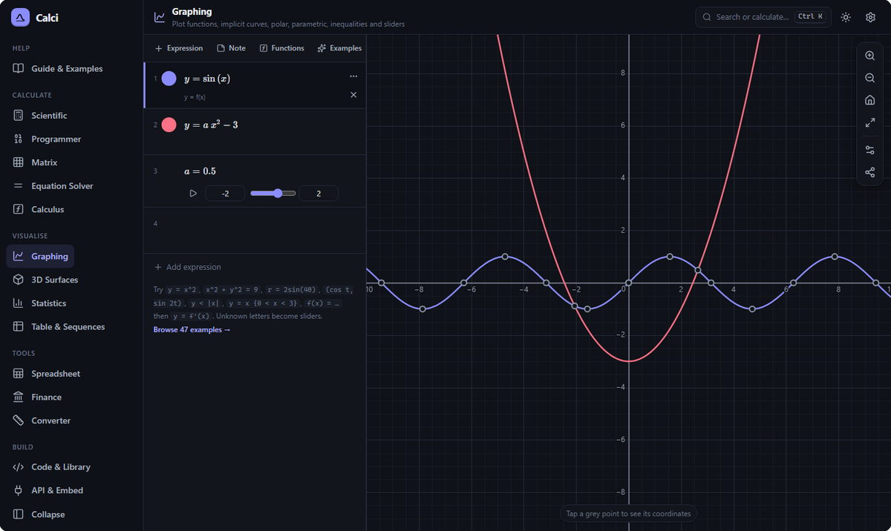
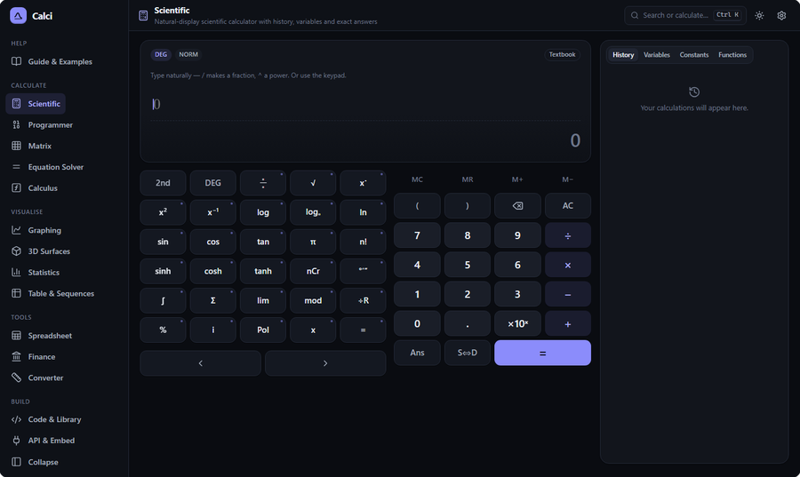
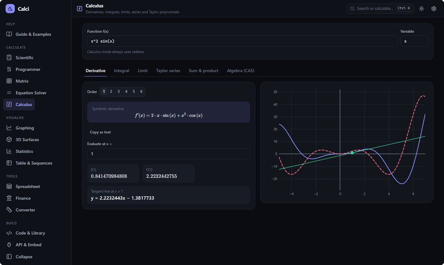

<!-- calci-header -->
<div align="center">



# Calci — web

**The all-in-one advanced calculator for the browser: scientific, graphing, 3D, CAS, statistics, finance and programmer modes, plus a REST API, JS SDK and embeddable widget.**

<a href="https://calci-web.vercel.app"></a>
<a href="https://github.com/flamekaizen/CALCI-W/actions/workflows/ci.yml"></a>
<a href="LICENSE"></a>


<a href="https://calci-web.vercel.app"><b>▶ Open Calci in your browser</b></a>

<sub>Part of the Calci family &nbsp;—&nbsp; <b>🌐 Web</b> &nbsp;·&nbsp; <a href="https://github.com/flamekaizen/CALCI-D">🖥️ Desktop</a> &nbsp;·&nbsp; <a href="https://github.com/flamekaizen/CALCI-M">📱 Mobile</a></sub>

<br/><br/>


<br/>



</div>
<!-- calci-header -->

All-in-one advanced calculator for the web, with an API, SDK and embeddable widgets.
Companion apps: **CALCI-M** (Android / iOS) and **CALCI-D** (Windows / macOS / Linux) wrap this build.

## Features

| Mode | Highlights |
| --- | --- |
| Scientific | Natural-display input, live preview, exact answers (fractions, √, π), DEG/RAD/GRAD, FIX/SCI/ENG, 64-digit precision, complex numbers, units, memory, Ans, variables, user functions, history, signature help and autocomplete |
| Graphing | `y = f(x)`, `x = g(y)`, implicit `F(x,y) = G(x,y)`, polar, parametric, inequalities with shading, points, domain restrictions `{0<x<2}`, piecewise `{x<0: -x, x}`, sliders with animation, roots / extrema / intersections, trace, pinch-zoom, PNG / SVG export, share links |
| 3D Surfaces | `z = f(x, y)` with lighting and height colouring, 3D parametric curves, rotate / zoom / auto-rotate |
| Programmer | HEX / DEC / OCT / BIN, 8–128-bit words, signed / unsigned, AND / OR / XOR / NOT / NAND / NOR / shifts / rotates, bit toggles, IEEE-754 inspector, characters |
| Matrix | Up to 10×10, determinant, inverse, RREF, rank, trace, eigenvalues / vectors, LU, QR, powers, norms, solve A·x = B, free expressions |
| Equation solver | Polynomials up to degree 50 (complex roots), linear systems with full classification, any equation f(x) = g(x) |
| Calculus | Symbolic derivatives (any order), tangent lines, definite integrals incl. infinite bounds, limits, Taylor polynomials, sums & products |
| Statistics | 1-var stats, frequencies, histogram & box plot, 9 regression models, 9 distributions, z / t / 2-sample t / proportion / χ² tests, confidence intervals |
| Finance | TVM solver (N, I/Y, PV, PMT, FV, BEGIN/END), amortisation, loan EMI, NPV / IRR / MIRR / payback, interest conversion, growth, depreciation, percentages |
| Converter | 18 unit categories, free-form queries (`5 ft + 3 inch to cm`), date differences and arithmetic |
| Code & Library | JavaScript and Python programs in a sandboxed worker (print / table / plot), and a function library shared by every mode |
| API & Embed | REST API, JS SDK, `<calci-calculator>` web component, postMessage control, SVG graph images |

Also: light / dark / system themes with six accents, command palette (`Ctrl K`) that doubles as a quick calculator, keyboard-first operation, offline PWA, responsive phone layout with bottom navigation, and no data leaves the device.

## Architecture

```
src/core/      Framework-free maths engine (math.js + custom numerics). Used by the UI, SDK, API and native apps.
  engine.ts      Stateful Calculator (scope, Ans, memory, library, safe mode)
  math.ts        Configured math.js: angle-aware trig, log/ln conventions, calculus functions
  compile.ts     Safe AST → native JS compiler for fast plotting and numerics
  graph/         Expression classifier, adaptive sampling, marching squares, analysis, SVG renderer
  numerics.ts    Gauss–Kronrod, Ridders, Brent, special functions, limits, series
  solver / calculus / stats / distributions / finance / units / programmer
src/app/       React UI (modes are code-split), zustand store persisted to localStorage
src/api/       REST handlers + OpenAPI spec (deployed by api/v1/*.ts on Vercel, served by Vite in dev)
src/sdk/       ESM / UMD SDK build entry
src/embed/     <calci-calculator> web component + postMessage bridge
src/workers/   Sandboxed script runner (JS, Python via Pyodide)
```

## Development

```bash
npm install
npm run dev        # http://localhost:5173 (the API is served at /api/v1 too)
npm test           # engine test-suite
npm run build      # typecheck + app + SDK + embed loader → dist/
npm run build:native   # relative-path build without service worker → dist-native/ (used by CALCI-M / CALCI-D)
```

Regenerate icons: `npm i --no-save sharp png-to-ico && node scripts/make-icons.mjs`.
Regenerate third-party notices: `node scripts/licenses.mjs`.

## API

`POST /api/v1/<endpoint>` with JSON (or `GET` with query parameters). Endpoints: `evaluate`, `simplify`, `derivative`, `integral`, `limit`, `taylor`, `solve`, `stats`, `distribution`, `convert`, `units`, `programmer`, `finance`, `plot` (SVG), `functions`, `openapi`.

```bash
curl -X POST https://<host>/api/v1/evaluate -H "Content-Type: application/json" -d '{"expr":"sin(30)+sqrt(16)","angle":"deg"}'
```

Untrusted input runs in safe mode (no `import`, `evaluate`, `createUnit`…, size limits). CORS is open.
For high-traffic public use, put the API behind a rate limiter (e.g. Vercel Firewall rules).

## Embedding

```html
<script src="https://<host>/sdk/calci-embed.js" defer></script>
<calci-calculator mode="graph" theme="light" expressions='["y=x^2"]' height="480"></calci-calculator>
```

See `/developers` in the app for the live embed builder, API explorer and SDK docs, and `/embed-demo.html` for a host-page example.

## Deploy

Vercel (`vercel.json` included): `npx vercel --prod`. Any static host works for the app itself; the API needs a Node runtime with web-standard `Request`/`Response` handlers.

## Licence

MIT © flamekaizen. Third-party notices: `public/licenses.txt`. All visual design, names and icons are original; no trademarks or assets of other calculator makers are used.

## What's new in 1.1

- **Textbook input** (default): fractions stack numerator over denominator, roots get a radical, powers rise, and ∫ / Σ / d/dx / log_b templates have boxes to fill — like the natural display of the Casio ClassWiz or TI MathPrint. Switch to one-line input from the display bar.
- **Every answer form at once**: fraction, mixed number, recurring decimal (0.1̅6̅), √ / π forms, D°M′S″, SI prefixes, prime factors, hex / binary, polar form for complex numbers.
- **Casio-style extras**: CALC-style value boxes for unknown letters, Verify mode (`2 + 2 = 4` → true), ÷R remainder division, DMS, Pol / Rec.
- **Graphing**: examples gallery ("What can I plot?", 47 examples), function palette, `f'(x)` / `f''(x)`, integrals and sums inside graphs (`y = integral(sin(t)/t, t, 0, x)`), zoom to fit.
- **New modes**: Guide & Examples (with "coming from Casio / TI / Desmos" maps), Table & Sequences, Spreadsheet.
- **CAS**: symbolic antiderivatives, factoring over ℚ, simplify / expand, polynomial and rational inequalities.
- **Solver**: Inequality and Ratio tabs. **Matrix**: Vectors tab (dot, cross, angle, projection, triple product).
